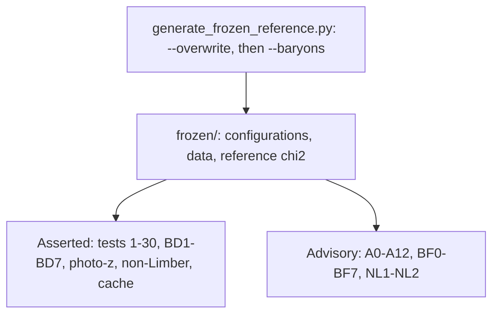
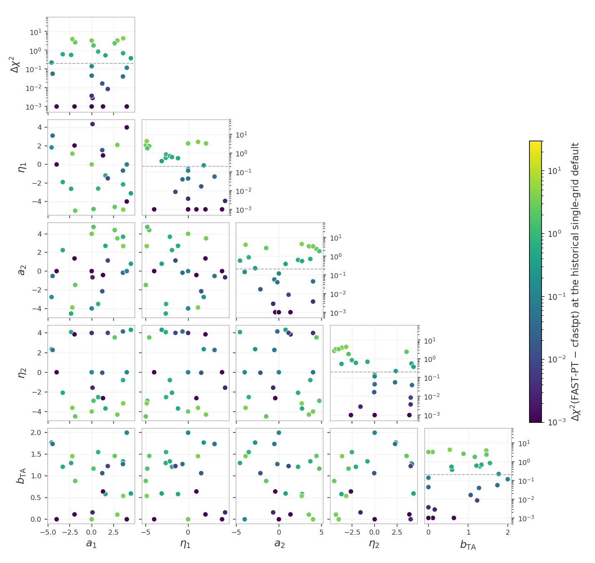
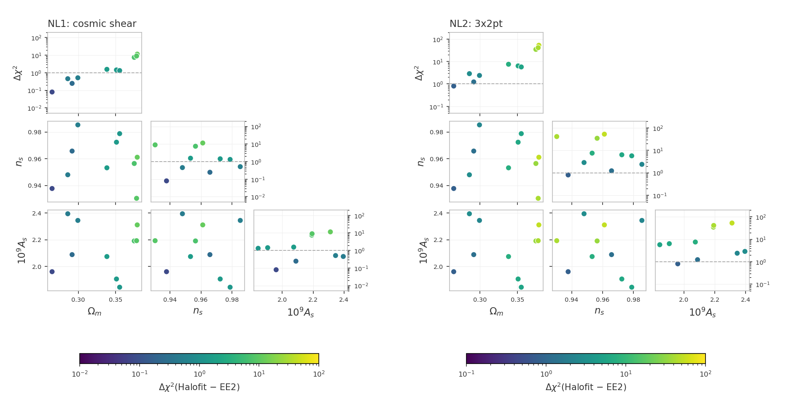
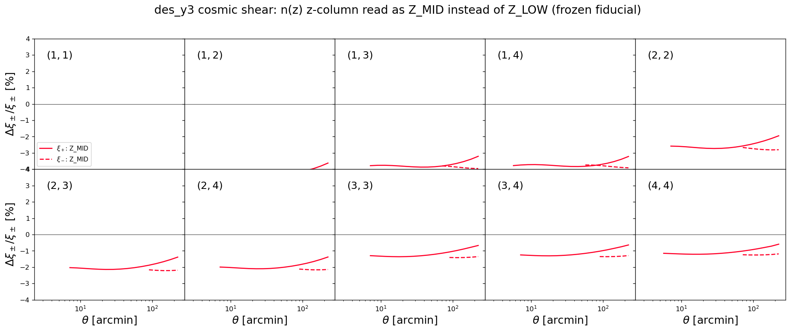
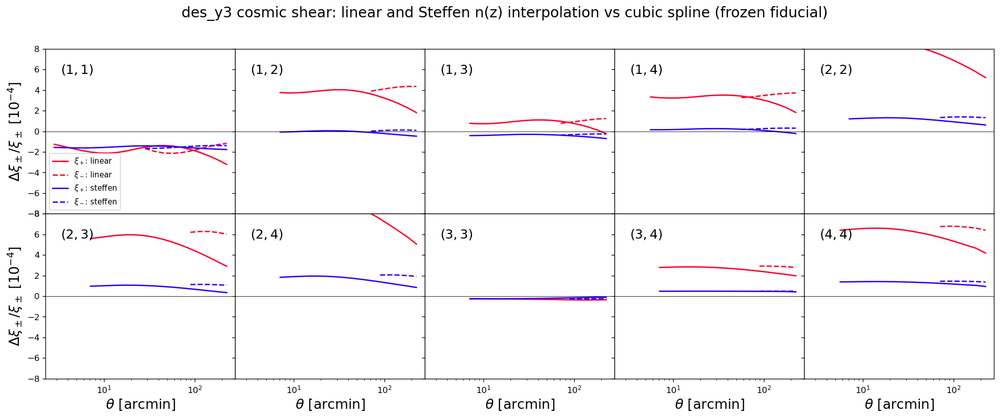

# Unit tests for the likelihoods

The frozen snapshot `frozen/` and its manifest `manifest_sha256.json`
live in the parent `tests/` directory; the paths below are relative to
it.

These tests catch two kinds of silent breakage: a $\chi^2$ that drifted
because code or data changed by accident, and a race condition (a bug
where evaluating several points in a row corrupts a later result
through leftover internal state or colliding OpenMP threads).

The project ships two generations of DES data, and the tests cover
both: tests 1-8, 11-14 and 27-30 run on the DES-Y3 data set
(`des_y3_real.dataset`), tests 15-26 on the DES-Y1 data set
(`des_y1_real.dataset`), through the same `des_y3.*` likelihood
classes. Each uses its data set's covariance, mask and n(z) with a
synthetic data vector ([Appendix](#frozen_copy)). Numbers 9 and
10 are unused.

Most checks build each model in its own worker subprocess: the Y1 and
Y3 data sets have different masked dimensions and n(z) table lengths,
and the cosmolike C layer aborts the whole process when a second
configuration with different dimensions initializes after the first.
The photo-z, non-Limber and cache checks build their models in the
pytest process itself. The isolation is internal; the commands below
stay the same.

The mechanism of every shared check family - the frozen-reference and
race contract, the zero-baseline construction, the sweeps and their
`--high`/`--mask` options, the accuracy settings and their meanings -
is documented once in
[the shared data-vector checks](https://github.com/CosmoLike/cocoa-cosmolike-core/blob/main/README.md#dv_checks)
of the CosmoLike core. This file records what des_y3 runs and what it
measured.

# Table of contents

1. [Running the tests](#run_tests)
2. [The tests](#the_tests)
    1. [The CFASTPT vs FASTPT comparison](#cfastpt_fastpt)
    2. [The Halofit vs EE2 checks](#halofit_ee2)
    3. [The EE2 race test](#ee2_race)
    4. [Accuracy checks](#accuracy_checks)
    5. [Baryonic feedback checks](#baryon_checks)
    6. [The photo-z convention checks](#photoz_conventions)
    7. [The non-Limber checks](#nonlimber_checks)
    8. [The sector-ladder cache check](#cache_ladder)
3. [Appendix](#appendix)
    1. [FAQ: What does this project's snapshot hold?](#frozen_copy)
    2. [FAQ: Why does the non-Limber clustering subtract a separable-growth term?](#gg_growth_fix)
    3. [FAQ: How can maintainers refresh the snapshot?](#refreeze)

## Running the tests 

We assume users are in the Conda cocoa environment from a previous
`conda activate cocoa` command, that the shell is bash, and that the
current folder is the cocoa main folder `cocoa/Cocoa`. Every command
below assumes `start_cocoa.sh` has been sourced once:

    source start_cocoa.sh

Run the full suite with

    python -m pytest ./projects/des_y3/tests/data_vector

or, without pytest,

    python -m unittest discover -s ./projects/des_y3/tests/data_vector -v

Under unittest the `--high` and `--mask` options below do not exist;
the FAST-PT and Halofit vs EE2 checks then run at their defaults
unless `COCOA_FASTPT_HIGH` and `COCOA_FASTPT_MASK` are exported.

The tests change no project files. Each test prints a progress line
per model build and per evaluation, then a report with the computed
$\chi^2$, the stored reference, the difference, and the pass limit.
A full run performs about 600 likelihood evaluations; the
high-accuracy checks alone take minutes each. The test files force
`OMP_NUM_THREADS=4` internally.

## The tests 

The standard configurations get four tests each - the frozen-reference
drift check and the race check, in NLA and in TATT
([mechanism](https://github.com/CosmoLike/cocoa-cosmolike-core/blob/main/README.md#dv_frozen)).
The TATT variants set

    IA_model: 1
    DES_A2_1: 0.05
    DES_BTA_1: 0.05
    DES_A2_2: -1.51541

The checks split into asserted regressions, which fail when a number
moves, and advisory reports, which print numbers without pass/fail:

The suite follows the shared
[test-file naming convention](https://github.com/CosmoLike/cocoa-cosmolike-core/blob/main/README.md#dv_naming): a file name
means the same thing in every project. This project's
configurations and test numbers:

| file | data | configuration | tests |
|---|---|---|---|
| `test_example1.py` | DES-Y3 | cosmic shear | 1-4 |
| `test_example2.py` | DES-Y3 | 3x2pt | 5-8 |
| `test_example2_2x2pt.py` | DES-Y3 | 2x2pt (`des_y3.combo_2x2pt`) | 11-14 |
| `test_example3.py` | DES-Y1 | cosmic shear | 15-18 |
| `test_example4.py` | DES-Y1 | 3x2pt | 19-22 |
| `test_example4_2x2pt.py` | DES-Y1 | 2x2pt (`des_y3.combo_2x2pt`) | 23-26 |
| `test_fastpt.py` | DES-Y3 | the sweep: shear; 3x2pt (`des_y3.combo_3x2pt`); 2x2pt (`des_y3.combo_2x2pt`) | 27, 28, 29 |
| `test_ee2.py` | DES-Y3 | race | 30 |

Tests 9 and 10 are not used: the numbering follows the shared
convention, where they are the frozen FAST-PT reference checks
this project does not ship.

### The CFASTPT vs FASTPT comparison (`test_fastpt.py`, tests 27-29) 

The sweep mechanism, the zero-baseline construction and the
`--high`/`--mask` options are in
[the shared checks](https://github.com/CosmoLike/cocoa-cosmolike-core/blob/main/README.md#dv_fastpt);
here the internal FFTLog grid holds 1,100 points, plus 200 per unit
of `internal_accuracyboost` above 1. Test 27 runs the sweep on cosmic
shear, test 28 on the 3x2pt likelihood (`des_y3.combo_3x2pt`) and
test 29 on the 2x2pt likelihood (`des_y3.combo_2x2pt`). In test 28
the frozen configuration fixes the one-loop bias amplitudes
(`DES_B2_*`) at zero, so the sweep scores the intrinsic-alignment
tables alone on the wider data vector; in test 29 clustering carries
no intrinsic alignment, so the TATT tables are scored through
galaxy-galaxy lensing alone.

The masks `--mask` accepts here (it also reruns the Halofit vs EE2
checks NL1-NL2): `frozen` (the default) keeps the baseline mask of
the frozen contract (533 of the 900 data points); `ones` keeps every
point (no scale cuts), the strictest comparison.

> [!NOTE]
> With one shared grid and no upsampling (the first row of the table
> below), the difference reaches $\Delta\chi^2 = 4.3$ across the prior.

The point values, the design, and the decision record live with the
lsst_y1 project (its tests/README.md carries the full discussion);
the table below is this project's own measurement:

| output table (points) | internal grid (points) | max $\Delta\chi^2$ | Runtime / first row |
|---|---|---|---|
| 1,100 | 1,100 (shared) | 4.32 | 1.00 |
| 1,024,900 (`accuracyboost: 1`, the default) | 1,100 (the default) | 0.000948 | 1.40 |
| 2,048,900 (`accuracyboost: 2`) | 1,300 (`internal_accuracyboost: 2`) | 0.000892 | 1.60 |

Runtime ratios use the first row of this table as the baseline, with the
same timed scope and machine. They compare sampling costs within this
project; absolute runtimes depend on the machine.

Measured:

- Test 28 (3x2pt): max $\Delta\chi^2 = 0.0010$ at the defaults,
  $0.000013$ at the pushed camb/cosmolike settings.
- Test 29 (2x2pt): $0.00010$ and $0.000001$, the mildest of the
  three, with the TATT tables entering through galaxy-galaxy
  lensing alone.
- `--mask=ones` (no scale cuts, all 900 points weighted): every
  sweep still passes. Cosmic shear measures max
  $\Delta\chi^2 = 0.055$ at the default camb/cosmolike settings,
  3x2pt 0.062, and 2x2pt 0.011; at the pushed settings they fall
  to 0.00004, 0.00006, and 0.00003.

The default-settings values are insensitive to the FAST-PT boosts
(cosmic shear's 0.055 is fifty-seven times its baseline-mask
value): the unmasked small scales amplify cosmolike's default
integration error, not a FAST-PT grid deficiency.

> [!NOTE]
> The fastpt defaults hold this accuracy on their own; raising the
> boosts is a convergence test, not a need. cfastpt (`IA_code: 0`)
> remains the reference implementation.

Run the comparison at the default and at the pushed camb/cosmolike
settings (the full comparison is both invocations):

    python -m pytest ./projects/des_y3/tests/data_vector/test_fastpt.py
    python -m pytest ./projects/des_y3/tests/data_vector/test_fastpt.py --high=1

### The Halofit vs EE2 checks (`test_nonlinear.py`, NL1-NL2) 

[Mechanism](https://github.com/CosmoLike/cocoa-cosmolike-core/blob/main/README.md#dv_halofit_ee2):
NL1 evaluates the DES-Y3 cosmic-shear data vector and NL2 the DES-Y3
3x2pt one, in the NLA configuration, with both nonlinear-power
sources at the ten shared cosmologies (halofit, `non_linear_emul: 2`,
is the frozen contract's setting). Measured (the figure below, frozen
mask):

- NL1 (cosmic shear): max $\Delta\chi^2 = 11.5$, median $1.4$;
  max $21.5$, median $2.4$ under `--mask=ones`.
- NL2 (3x2pt): max $53.0$, median $6.0$; max $243.0$, median
  $42.6$ under `--mask=ones`.

Run them under the frozen contract mask and with every data point
kept:

    python -m pytest ./projects/des_y3/tests/data_vector/test_nonlinear.py
    python -m pytest ./projects/des_y3/tests/data_vector/test_nonlinear.py --mask=ones

### The EE2 race test (`test_ee2.py`, test 30) 

[Mechanism](https://github.com/CosmoLike/cocoa-cosmolike-core/blob/main/README.md#dv_ee2):
the gate that compiles the pre-modification EuclidEmulator2 build and
compares the two builds' data vectors runs as the lsst_y1 project's
test 18 and is not repeated here. Test 30 is the race check with EE2
on, on the DES-Y3 cosmic-shear configuration (`non_linear_emul: 1`);
every other race check in the table runs with halofit
(`non_linear_emul: 2`, the frozen contract's setting), so only this
row executes EE2's OpenMP-threaded compute. Measured:

- Test 30: the fresh and 10th-in-a-row fiducial agree to all eight
  printed decimals.
- The modified EE2 build against the unmodified EuclidEmulator2, at ten
  fixed cosmologies on this project's cosmic shear under the frozen
  mask: max $\Delta\chi^2 = 3.0\times10^{-8}$, with a max
  fractional data-vector difference of $7.4\times10^{-6}$.

### Accuracy checks (`test_accuracy.py`, A0-A12) 

[Mechanism, setting meanings and cost order](https://github.com/CosmoLike/cocoa-cosmolike-core/blob/main/README.md#dv_accuracy):
check A0, which runs first, changes one accuracy parameter at a time
on the DES-Y3 3x2pt NLA configuration, so a large $\Delta\chi^2$ can
be attributed to the parameter causing it; A1-A12 re-evaluate cosmic
shear, 3x2pt and 2x2pt, in NLA and TATT, on the DES-Y3 data (A1-A6)
and on the DES-Y1 data (A7-A12), with every setting pushed at once.
This project's pushed values:

| setting | raised to |
|---------|-----------|
| `accuracyboost` (cosmolike) | 3 (A0 also tries 5) |
| `integration_accuracy` (cosmolike) | 10 |
| `internal_accuracyboost` (cosmolike) | 2 |
| `lmax` (cosmolike) | 200000 |
| `kmax_boltzmann` (cosmolike) | 40 |
| `AccuracyBoost` (CAMB) | 2 |
| `k_per_logint` (CAMB) | 50 |
| `kmax` (CAMB) | 50 |

The nested-grid construction `accuracyboost` refines is commented in
`likelihood/_cosmolike_prototype_base.py`. This project's
`internal_accuracyboost` default, 1.0, keeps the convolution grid
equal to the output table: the exact single-grid path. The lsst_y1
scan measured $\Delta^T C^{-1} \Delta \le 10^{-9}$ against that path
for grid fractions down to 0.27.

Run them on their own, or skip them (high-accuracy evaluations take
minutes):

    python -m pytest ./projects/des_y3/tests/data_vector/test_accuracy.py
    python -m pytest ./projects/des_y3/tests/data_vector --ignore ./projects/des_y3/tests/data_vector/test_accuracy.py

### Baryonic feedback checks (`test_accuracy_baryons.py`, BF1-BF7; `test_baryons.py`, BD1-BD7) 

[Mechanism](https://github.com/CosmoLike/cocoa-cosmolike-core/blob/main/README.md#dv_baryons):
the accuracy checks (BF) report the default-versus-pushed
$\Delta\chi^2$ with each feedback method on, one advisory check per
method; check BF0 additionally runs the one-setting-at-a-time scan
with the Akino SP(k) feedback on, so a large delta names the setting
causing it. The drift tests (BD) pin each method's frozen prediction
(`generate_frozen_reference.py --baryons`), one test per method.

Every checked configuration is measurable by construction: the
BACCOemu check evaluates with `omegab: 0.049`, inside that emulator's
baryon-density training box, whose floor sits exactly above the
fiducial `omegab: 0.04`; and the double-power-law point is chosen to
keep the baryon fraction inside SP(k)'s calibrated band over the full
redshift grid.

Run them with

    python -m pytest ./projects/des_y3/tests/data_vector/test_accuracy_baryons.py
    python -m pytest ./projects/des_y3/tests/data_vector/test_baryons.py

### The photo-z convention checks (`test_photoz_conventions.py`) 

[Mechanism](https://github.com/CosmoLike/cocoa-cosmolike-core/blob/main/README.md#dv_photoz):
the frozen cosmic-shear fiducial under the default, each alternative
convention, and the default again. `scripts/README.md` lists the DES
FITS files the n(z) tables come from and how to write the tables with
either z column. Measured:

- default: the test requires the frozen reference of the cosmic-shear
  NLA configuration, $\chi^2 = 0.000103$.
- linear: $\Delta\chi^2 = 3.1\times10^{-4}$; Steffen:
  $\Delta\chi^2 = 1.6\times10^{-5}$. Either interpolant change is far below
  the survey's statistical precision.
- Z_MID: $\Delta\chi^2 = 0.30$ - the half-bin z-column reading
  is the one photo-z convention that matters at this precision.

The figures below are regenerated by
`generate_photoz_convention_figure.py`:

### The non-Limber checks (`test_nonlimber_ggl.py`, `test_nonlimber_gg.py`) 

[Mechanism](https://github.com/CosmoLike/cocoa-cosmolike-core/blob/main/README.md#dv_nonlimber):
in this project galaxy-galaxy lensing defaults to Limber
(`adopt_limber_gs: 1`) because its lensing kernel is broad and the
measured difference below is far below the survey's statistical
precision, while galaxy clustering defaults to the exact projection
below $\ell = 150$ (`adopt_limber_gg: 0`): the narrow lens
distributions make the Limber approximation fail at low $\ell$ for
the clustering auto spectra.

Galaxy-galaxy lensing, measured:

- $\Delta\chi^2 = 0.012$ for the Y3 3x2pt data vector (example2),
  far below the survey's statistical precision; the largest pairs,
  (3,2) and (4,2), contribute 0.007 and 0.006. The test pins
  $\Delta\chi^2 = 0.01214$ to 5%.

Galaxy clustering, measured:

- $\Delta\chi^2 = 9.49$ for the Y3 3x2pt data vector (example2), against
  0.012 for the same comparison in galaxy-galaxy lensing. The test pins
  $\Delta\chi^2 = 9.492$ to 5%.
- Lens bins 4, 3, 2, 1, 0 contribute 4.56, 2.44, 1.75, 0.61, 0.19
  (each bin's block alone).

### The sector-ladder cache check (`test_cache_consistency.py`) 

The deterministic mixed-update ladder and its bitwise assertions are
described in
[the shared checks](https://github.com/CosmoLike/cocoa-cosmolike-core/blob/main/README.md#dv_cache_ladder).
This project's ladder takes three steps in each sector in turn
(cosmology, intrinsic alignment, source photo-z, lens photo-z and
shear calibration), requires every step to change the data vector,
and the final scramble includes galaxy bias.

## Appendix 

## :interrobang: FAQ: What does this project's snapshot hold? 

The snapshot-protection mechanism is described in
[the shared checks](https://github.com/CosmoLike/cocoa-cosmolike-core/blob/main/README.md#dv_frozen);
here the manifest check also refuses to run when a file under
`frozen/` was added or removed, not only edited. Cobaya still loads
the likelihood classes with their default yaml files, but the frozen
configurations override every option and parameter they list. This
project's `frozen/` holds:

| `frozen/` entry | holds |
|---|---|
| `frozen_config_example*.py` | the complete cobaya configuration as a yaml string, plus the exact evaluation point |
| `data/` | the tests' own copy of the data vectors, covariances, n(z), and masks of both data sets, plus the synthetic and baryonic-feedback data vectors the tests evaluate against |
| `reference_chi2.json` | the twelve reference $\chi^2$ values, one per configuration and intrinsic-alignment model |
| `EXAMPLE_EVALUATE{1,2,3,4}.yaml` | snapshots kept only so a human can diff how the live examples drifted since the freeze |

This project's shipped data vectors are real data (the DES-Y3 and
DES-Y1 measurements), and the example cosmology is not a best fit of
either, so the $\chi^2$ there sits far from the minimum, where it
responds linearly to tiny numerical changes
([why that matters](https://github.com/CosmoLike/cocoa-cosmolike-core/blob/main/README.md#dv_frozen)).
Every variant therefore evaluates against a data vector generated at
the fiducial point when the snapshot was created, one pair per data
set:

| data | NLA vector | TATT vector | generated from |
|------|-----------|-------------|----------------|
| DES-Y3 | `frozen/data/synthetic_des_y3.dataset` | `frozen/data/tatt_des_y3.dataset` | the 3x2pt model |
| DES-Y1 | `frozen/data/synthetic_des_y1.dataset` | `frozen/data/tatt_des_y1.dataset` | the DES-Y1 3x2pt model |

Within a data set the full-length 3x2pt vector serves every probe
(the masks select their sections); at its own minimum the $\chi^2$
response is quadratic and the drift and accuracy numbers stay
meaningful.

## :interrobang: FAQ: Why does the non-Limber clustering subtract a separable-growth term? 

Below $\ell = 150$ cosmolike's `C_cl_tomo` computes

$$C_\ell = C_\ell^{\rm FFTLog}(P_{\rm lin}) + C_\ell^{\rm Limber}(P_\delta) - C_\ell^{\rm Limber}(P_{\rm lin}),$$

an exact FFTLog projection of the linear power spectrum plus, in the
Limber approximation, what linear theory misses. Where the Limber
approximation holds (high $\ell$) the first and third terms must
converge to the same number and cancel, leaving the Limber
$C_\ell^{gg}$. The FFTLog term needs a separable linear spectrum,
$(D(a)/D(a_{\rm piv}))^2 P_{\rm lin}(k, a_{\rm piv})$, anchored at a
pivot scale factor $a_{\rm piv}$ of each lens bin, so the subtracted
Limber term uses the identical separable form.

CAMB's $P_{\rm lin}(k, a)$ would not cancel the FFTLog term: massive
neutrinos make its growth scale dependent, and an uncancelled pair
leaves an offset in every $C_\ell^{gg}$ below the switch to Limber.
The scale-dependent part of the growth stays in the Limber $P_\delta$
term, where the split puts it. The non-Limber galaxy-galaxy lensing
spectrum of `C_gs_tomo` (`adopt_limber_gs: 0`) uses the same
separable form.

## :interrobang: FAQ: How can maintainers refresh the snapshot? 

A deliberate change to the data vectors, n(z), covariance, examples,
or likelihood defaults requires a re-freeze.

We assume users are in the Conda cocoa environment from a previous
`conda activate cocoa` command, that the shell is bash, and that the
current folder is the cocoa main folder `cocoa/Cocoa`.

**Step :one:**: activate the private Python environment by sourcing
the script `start_cocoa.sh`

    source start_cocoa.sh

**Step :two:**: rebuild the snapshot

    python ./projects/des_y3/tests/generate_frozen_reference.py --overwrite

It deletes `frozen/`, rebuilds it from the current project, prints the
twelve new reference $\chi^2$ values, and rewrites the manifest. It does
not regenerate the baryonic-feedback vectors of the drift tests.

**Step :three:**: regenerate the baryonic-feedback vectors and re-pin
the manifest

    python ./projects/des_y3/tests/generate_frozen_reference.py --baryons

Review the printed $\chi^2$ values against the committed references
before committing: they define what every later test run compares
against.
